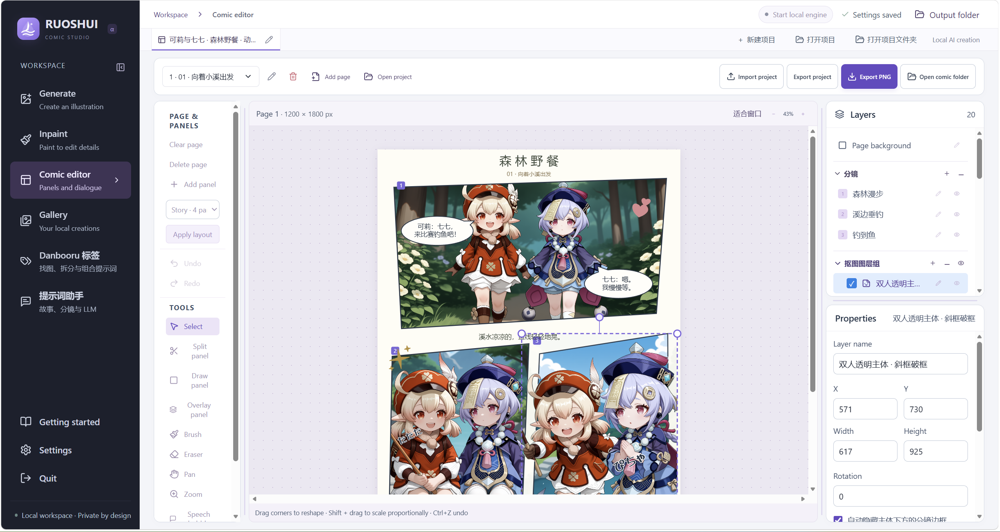
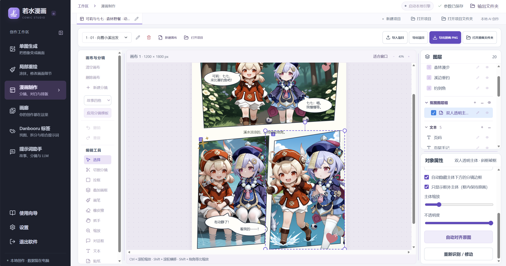

# Ruoshui Comic · 若水漫画

[简体中文](README.md) · [Download](https://github.com/Penumbrill/ruoshui-comic/releases/latest) · [Report an issue](https://github.com/Penumbrill/ruoshui-comic/issues)

A local AI comic studio for Windows, designed for beginners. Generate images, refine details, arrange panels, add dialogue and export comic pages in one workspace.

Includes an independent runtime, with no separate image-generation application to configure. Download models as needed and keep your artwork and projects on your own computer.

## Features

- **Image generation and inpainting** — Generate images from prompts or paint over a selected area to edit it. Upload images, drag and drop files, or choose from your gallery.
- **Comic layouts** — Create multipage projects, apply panel templates, edit slanted and polygonal frames, and arrange images, dialogue, text and stickers.
- **Cutouts beyond panel borders** — Extract subjects, refine their edges, extend them outside a panel and realign them with the original image.
- **Typography and dialogue** — Link dialogue bubbles, use horizontal or vertical text, and adjust fonts and formatting. Includes Chinese and English fonts, system font selection and font import.
- **Prompts and tags** — Browse a categorized dictionary with fuzzy search, favorites and import/export. Use the prompt assistant with a local model or an optional online service.
- **Saving and export** — Autosave your edits, manage a local gallery, and export PNG pages or complete project ZIPs containing images, stickers, fonts, project files and the last editing state. Importing a project restores that state.

When deleting a project, keep its images or move related content to the recycle bin. Images used by other projects are kept. Deleted projects can be restored from the local recycle bin.

Open Settings → Cache & storage to browse the recycle bin, restore projects and images, or empty it after confirmation. It is never cleared automatically. Permanent deletion cannot be undone.

## Screenshots

English interface: comic editor, layers and object properties.



Chinese interface: panel layouts, dialogue, stickers and cutouts extending beyond panel borders.



## System and storage requirements

| Item | Details |
| --- | --- |
| Operating system | 64-bit Windows; current releases target x64 |
| GPU | A CUDA-capable NVIDIA GPU is recommended. Speed and VRAM requirements depend on the model, resolution and features used. |
| Memory | 16 GB or more recommended |
| Storage | About 3 GB to download the application and runtime, and about 5 GB after extraction. Allow additional space for installation caches and models. |
| Internet | Required to download the application, runtime and models, and to use online tag search or the optional online assistant. |

Local generation uses the application's own Python, inference dependencies and engine directory, together with the system's installed GPU driver.

## Download and install

Get the files from [GitHub Releases](https://github.com/Penumbrill/ruoshui-comic/releases/latest). Choose either the installer or manual extraction. On first launch, the app automatically downloads Chinese-to-English and English-to-Chinese translation models and shows their progress. Image-generation models can be downloaded from within the app.

### Option 1: Installer

1. Download and run **`ruoshui-comic.exe`**.
2. Choose an installation folder on your preferred drive.
3. Wait for the installer to download, verify and extract the application and runtime, then launch the app.

The installer supports resumable downloads and automatically tries available network connection methods. Run it again to continue an interrupted installation. Once installed, launch the app using its desktop shortcut or **`若水漫画.exe`** in the installation folder.

### Option 2: Manual portable installation

Download all **five ZIP files** from the same Release:

| File | Contents |
| --- | --- |
| `ruoshui-comic.update-win-x64.zip` | Main application; also required for a first installation |
| `ruoshui-runtime-win-x64-01.zip` | Runtime package 1 |
| `ruoshui-runtime-win-x64-02.zip` | Runtime package 2 |
| `ruoshui-runtime-win-x64-03.zip` | Runtime package 3 |
| `ruoshui-runtime-win-x64-04.zip` | Runtime package 4 |

Create an empty folder, for example `E:\RuoshuiComic`. Right-click each ZIP and choose **Extract All**, setting the destination to **that same folder every time**. These are ordinary, independently extractable ZIP files; their contents combine into one installation.

```text
RuoshuiComic/
├─ 若水漫画.exe
├─ resources/
└─ runtime/
```

After extracting all five ZIPs, launch **`若水漫画.exe`**. Keep the entire folder together when moving the portable app.

`ruoshui-setup-guide.zip` is an optional package containing instructions and verification tools. To verify the downloads, extract it into the application folder, keep the original ZIP files there, and run `校验整合包.cmd` inside the `安装说明` subfolder.

The `Source code` downloads on the Release page are for developers. To use the app, choose the installer or portable packages above.

## Create your first comic

1. **Check the environment.** Open the environment check in Settings and confirm the runtime and GPU status.
2. **Prepare models.** Download or import the models you need in the model manager. By default, models are stored inside the current application folder, independently of other image-generation installations.
3. **Generate or import images.** Enter a prompt in Generate, or upload an existing image to edit with Inpaint.
4. **Build a comic.** Create a project and page, add panels and images, then arrange dialogue, text, stickers and layers.
5. **Export your pages.** Choose Export PNG. Pages are saved in a folder named after the project; use Open comic folder to view them.

Standalone generation and inpainting save their own results. Results fill a comic panel only when generation or inpainting was opened for that specific panel. Ordinary standalone work does not automatically add images to a comic.

## Common controls

| Action | Control |
| --- | --- |
| Zoom the main comic canvas | Ctrl + mouse wheel |
| Zoom other image previews | Mouse wheel; double-click to fit |
| Adjust numeric values | Scroll over the numeric control; hold Shift for larger steps |
| Reset parameters | Use the reset button beside a parameter, or reset all parameters in Settings |
| Reorder layers | Right-click a layer to move it within its group or across layer types |
| Realign a cutout | Select it and use Align to original in Properties |
| Import fonts | Import TTF, OTF, WOFF or WOFF2 files from the font selector |

## Data and backups

Project files, application settings and the independent runtime are stored in these locations:

| Location | Contents |
| --- | --- |
| `works/` | Projects, images, settings, autosaves, dictionaries and logs |
| `works/exports/` | Exported comic pages, organized by project name |
| `works/fonts/` | Imported fonts |
| `runtime/` | Independent runtime and models |
| `runtime/ComfyUI/models/` | Model files grouped by type |

Back up `works` regularly, along with any models you want to keep. When you move the complete portable folder, subsequent downloads and artwork are stored at its new location.

## Feedback

Report problems in [Issues](https://github.com/Penumbrill/ruoshui-comic/issues). Include steps to reproduce, an error screenshot, your operating system and GPU, and the environment check results.

## License

Original project code is licensed under the [MIT License](LICENSE). Third-party components, fonts and tag data retain their respective licenses; required copyright and source information is preserved in [Third-party notices](THIRD_PARTY_NOTICES.md). Models and imported assets remain subject to their own terms.
